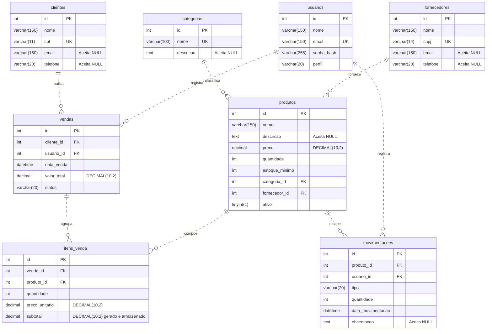

# Modelo Entidade-Relacionamento do StockWeb

O modelo de dados do StockWeb organiza os cadastros de usuários, produtos, categorias, fornecedores e clientes e os relaciona às vendas, aos itens vendidos e às movimentações de estoque. O diagrama foi elaborado exclusivamente a partir de [database/schema.sql](../database/schema.sql).

## Diagrama

**PK** indica chave primária, **FK** indica chave estrangeira e **UK** indica chave única. As oito tabelas têm uma chave primária `id` com `AUTO_INCREMENT`. A precisão e a escala de `DECIMAL(10,2)` aparecem nos comentários dos atributos para preservar a sintaxe do Mermaid.

## Relacionamentos e cardinalidades

| Origem da referência | Destino da referência | Cardinalidade |
| --- | --- | --- |
| `produtos.categoria_id` | `categorias.id` | Cada produto pertence a uma categoria. Uma categoria pode classificar zero ou muitos produtos. |
| `produtos.fornecedor_id` | `fornecedores.id` | Cada produto tem um fornecedor. Um fornecedor pode fornecer zero ou muitos produtos. |
| `vendas.cliente_id` | `clientes.id` | Cada venda está associada a um cliente. Um cliente pode ter zero ou muitas vendas. |
| `vendas.usuario_id` | `usuarios.id` | Cada venda tem um usuário responsável. Um usuário pode registrar zero ou muitas vendas. |
| `itens_venda.venda_id` | `vendas.id` | Cada item pertence a uma venda. O esquema permite zero ou muitos itens por venda. |
| `itens_venda.produto_id` | `produtos.id` | Cada item referencia um produto. Um produto pode aparecer em zero ou muitos itens de venda. |
| `movimentacoes.produto_id` | `produtos.id` | Cada movimentação referencia um produto. Um produto pode ter zero ou muitas movimentações. |
| `movimentacoes.usuario_id` | `usuarios.id` | Cada movimentação tem um usuário responsável. Um usuário pode registrar zero ou muitas movimentações. |

`itens_venda` faz a ligação entre vendas e produtos e guarda a quantidade e o preço unitário de cada item. O MySQL calcula `subtotal` como `quantidade * preco_unitario` e armazena o resultado em uma coluna gerada. O histórico em `movimentacoes` referencia diretamente o produto e o usuário.

## Integridade referencial

- As oito chaves estrangeiras são `NOT NULL` e apontam para chaves primárias. Cada registro que contém uma FK precisa referenciar exatamente um registro existente.
- As colunas de FK têm índices comuns. O esquema permite que vários registros referenciem o mesmo pai e não exige que um pai tenha registros dependentes. As linhas pontilhadas indicam que as FKs não integram a chave primária da tabela dependente.
- Nas tabelas InnoDB, as FKs sem ações explícitas de `ON DELETE` ou `ON UPDATE` impedem excluir um registro referenciado ou alterar sua chave enquanto existirem dependentes.
- As restrições `CHECK` limitam os perfis, os status de venda e os tipos de movimentação. Também exigem quantidades positivas nos itens e nas movimentações, saldo e preço de produto não negativos, preço unitário de item não negativo e valor total de venda não negativo.
