# Protótipo visual — StockWeb

Este protótipo de referência documenta as telas reais do StockWeb para o Trabalho A3 de PHP. As 12 capturas mostram a interface desktop em `http://localhost:8081`, com os formulários, as tabelas e a navegação lateral da aplicação.

As imagens foram capturadas no Chrome a partir das páginas em execução. Nomes, contatos, identificadores pessoais, observações e valores de venda foram ocultados ou substituídos na apresentação do navegador. Os exemplos selecionados nos formulários de nova venda e nova movimentação são apenas ilustrativos. Nenhum formulário foi enviado e nenhum registro foi alterado para a preparação das telas.

## Fluxo de navegação

1. **Login → Dashboard.** Entre no sistema e acompanhe os indicadores. A partir do Dashboard, use a sidebar para abrir os módulos.
2. **Cadastros.** Em **Produtos**, abra **Novo produto** para acessar o formulário. Em **Categorias**, **Fornecedores** e **Clientes**, a listagem oferece ações de cadastro, edição e exclusão conforme os vínculos existentes.
3. **Vendas.** Abra **Vendas → Nova venda**, selecione o cliente, adicione produtos e informe quantidades. Uma venda concluída atualiza o estoque e registra as saídas no histórico.
4. **Estoque.** Abra **Movimentações → Nova movimentação** para registrar uma entrada ou saída manual. A listagem permite consultar os lançamentos e aplicar filtros.
5. **Relatórios.** Escolha uma aba, aplique os filtros e use **Exportar PDF** para abrir a versão de impressão. O arquivo pode ser salvo pelo navegador. A ação **Sair**, no rodapé da sidebar, encerra a sessão.

## Telas capturadas

### 1. Login

A tela apresenta os campos de e-mail e senha e a ação **Entrar**. Os campos estão vazios na captura. [Rota PHP](../public/login.php)

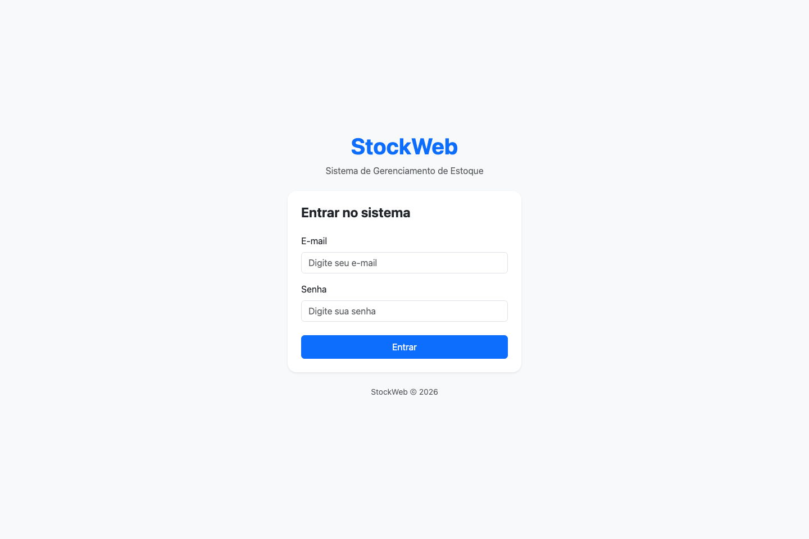

### 2. Dashboard

Os cards resumem produtos ativos, clientes, vendas concluídas e alertas de estoque. O painel também exibe produtos recentes e identifica a conta da sessão. [Rota PHP](../public/dashboard.php)

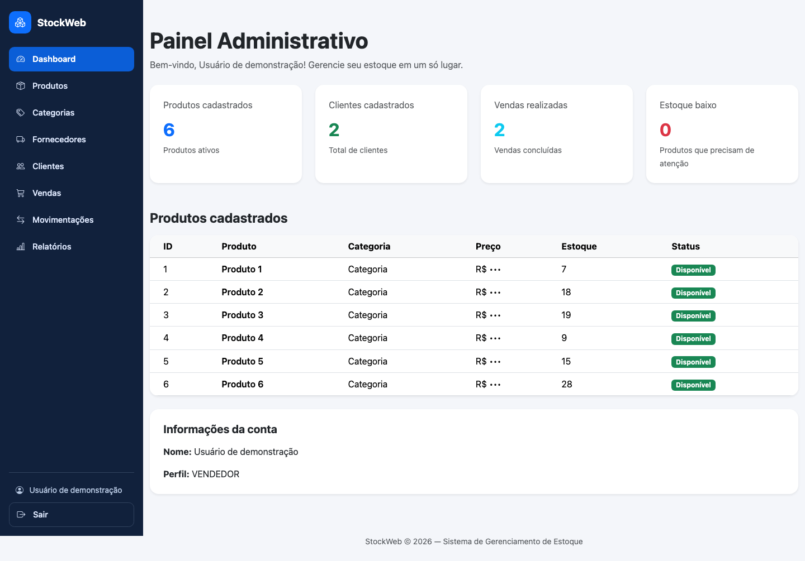

### 3. Listagem de produtos

A tabela de produtos ativos mostra categoria, fornecedor, preço, quantidade e situação do estoque. A tela oferece acesso ao cadastro, à edição e à desativação de produtos. [Rota PHP](../public/produtos.php)

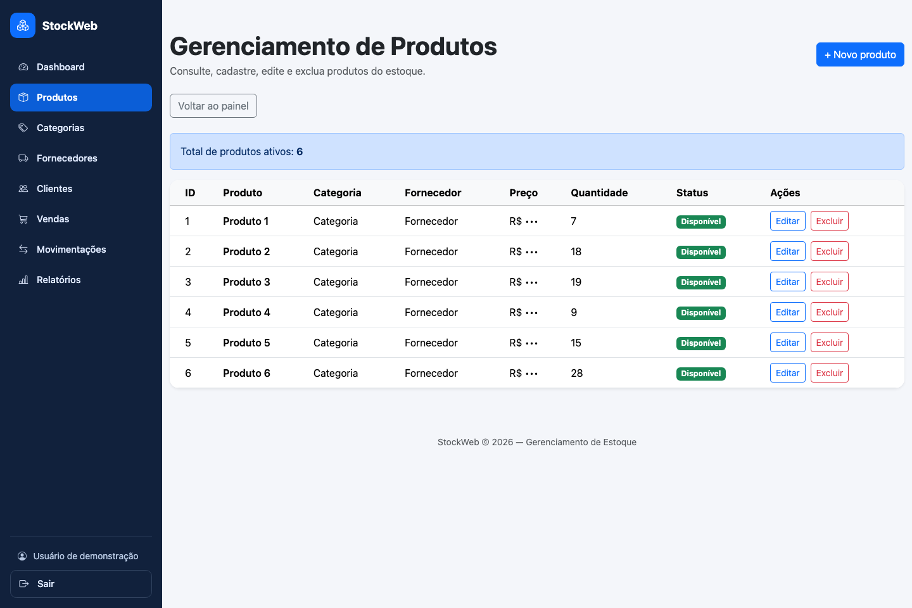

### 4. Cadastro de produto

O formulário reúne nome, descrição, preço, estoque inicial e mínimo, categoria e fornecedor. [Rota PHP](../public/produto_novo.php)

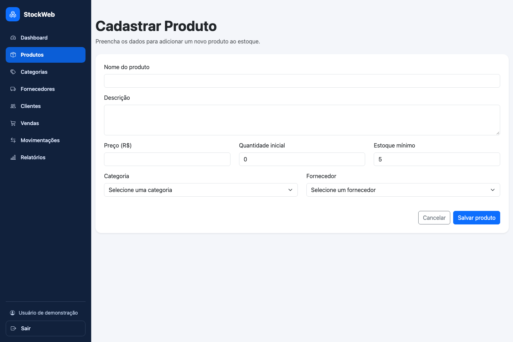

### 5. Categorias

A lista mostra as categorias e a contagem de produtos ativos. A exclusão fica indisponível quando há produtos vinculados. [Rota PHP](../public/categorias.php)

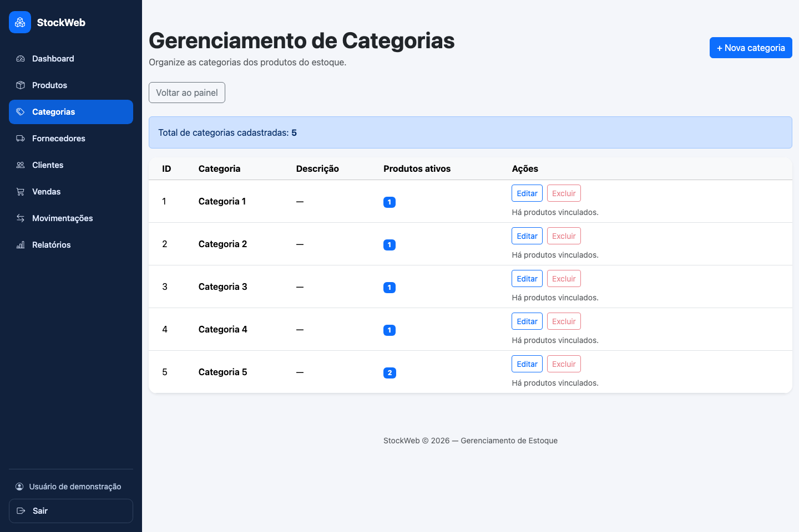

### 6. Fornecedores

A tela reúne os dados cadastrais dos fornecedores e as ações de gerenciamento. CNPJ e contatos estão ocultados na imagem. [Rota PHP](../public/fornecedores.php)

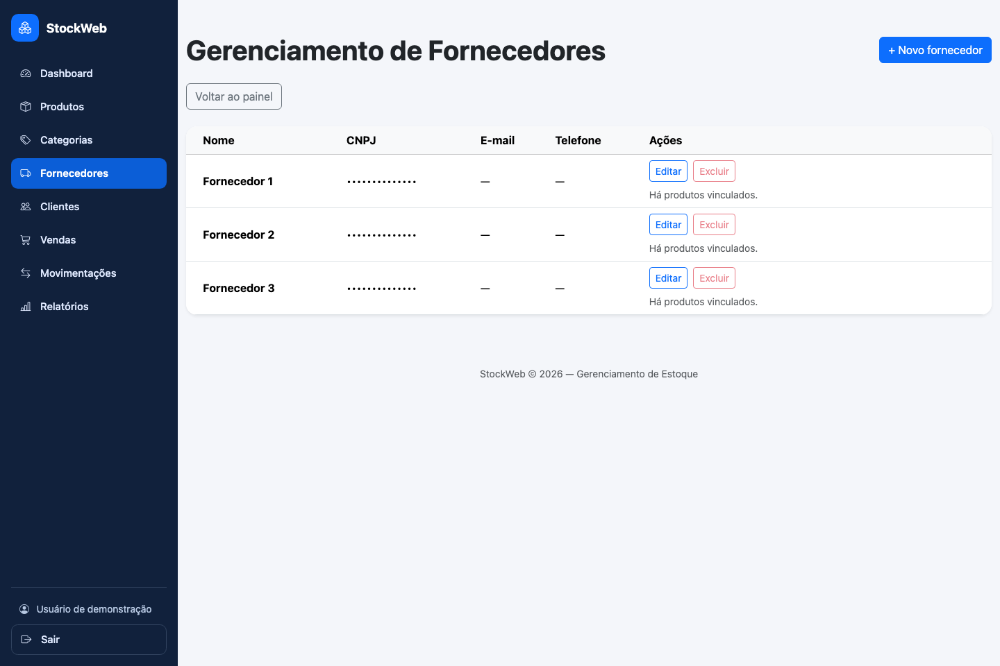

### 7. Clientes

A tela lista os clientes e oferece cadastro e edição. A exclusão fica indisponível para clientes com vendas vinculadas. CPF e contatos estão ocultados na imagem. [Rota PHP](../public/clientes.php)

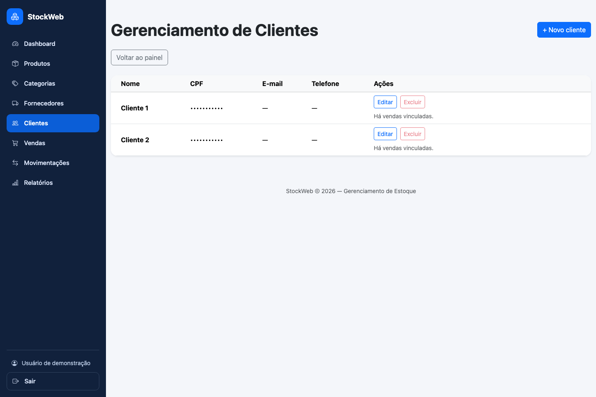

### 8. Listagem de vendas

A lista reúne número, data, cliente, status e total. Cada linha oferece **Detalhes**, e o cabeçalho dá acesso a **Nova venda**. [Rota PHP](../public/vendas.php)

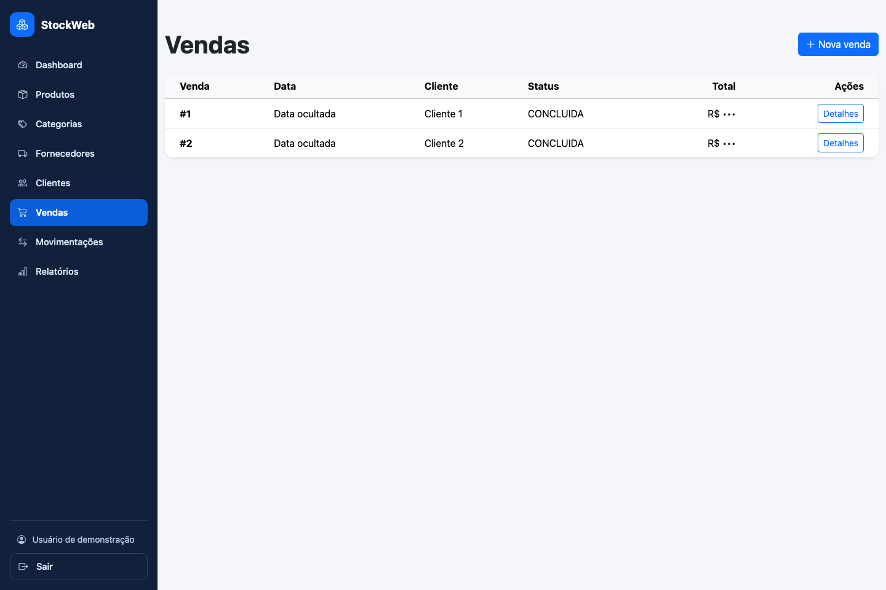

### 9. Nova venda

O formulário permite selecionar cliente e produtos, informar quantidades e conferir preço unitário, subtotal e total. A imagem mostra uma seleção ilustrativa, sem concluir a operação. [Rota PHP](../public/venda_nova.php)

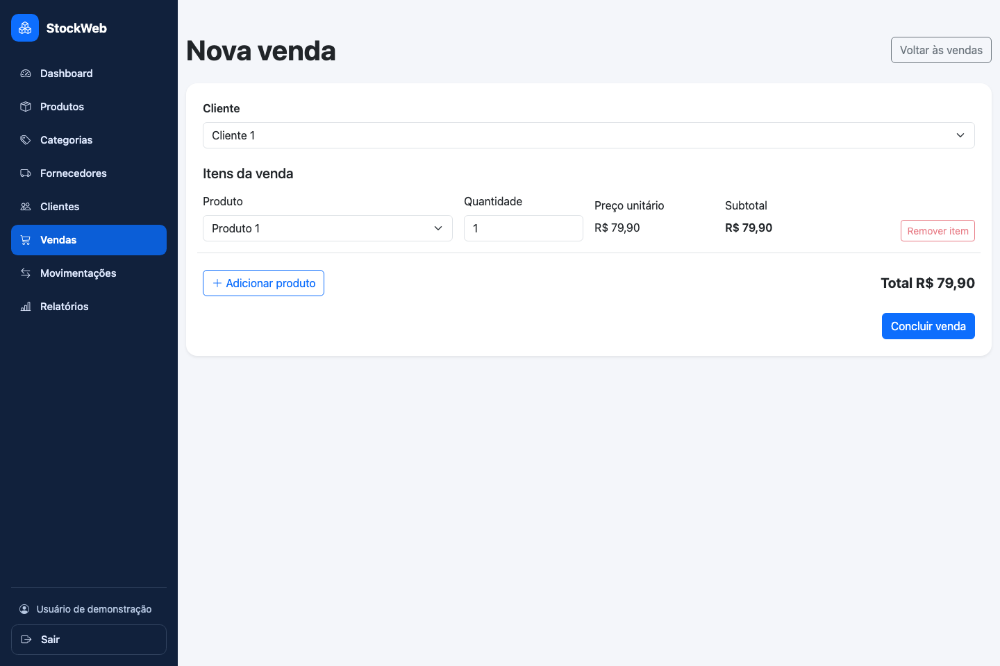

### 10. Movimentações de estoque

O histórico reúne produto, tipo, quantidade, horário, responsável e observação. Os filtros disponíveis são produto, tipo e período. [Rota PHP](../public/movimentacoes.php)

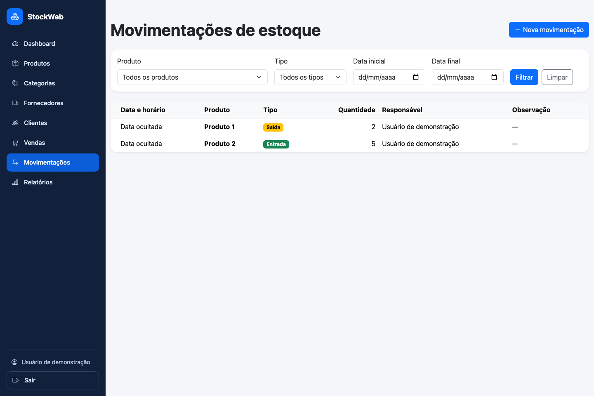

### 11. Nova movimentação

O formulário exibe o saldo do produto selecionado e permite informar tipo, quantidade e observação. A seleção exibida é ilustrativa. [Rota PHP](../public/movimentacao_nova.php)

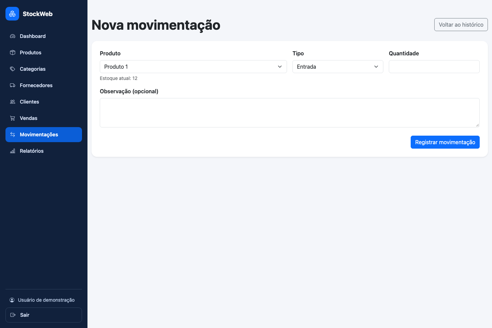

### 12. Relatórios

A imagem mostra a aba **Produtos e estoque**, com filtros combináveis, indicadores e tabela. A navegação também oferece **Resumo geral**, **Vendas** e **Movimentações registradas**. [Rota PHP](../public/relatorios.php)

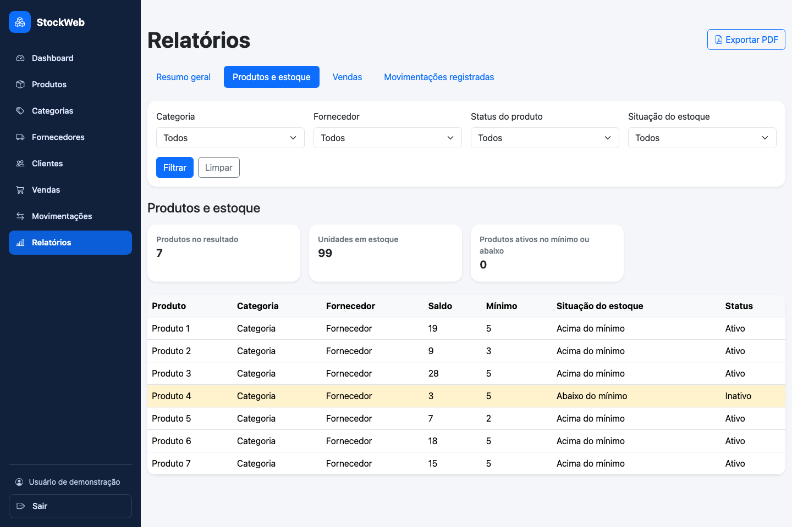
